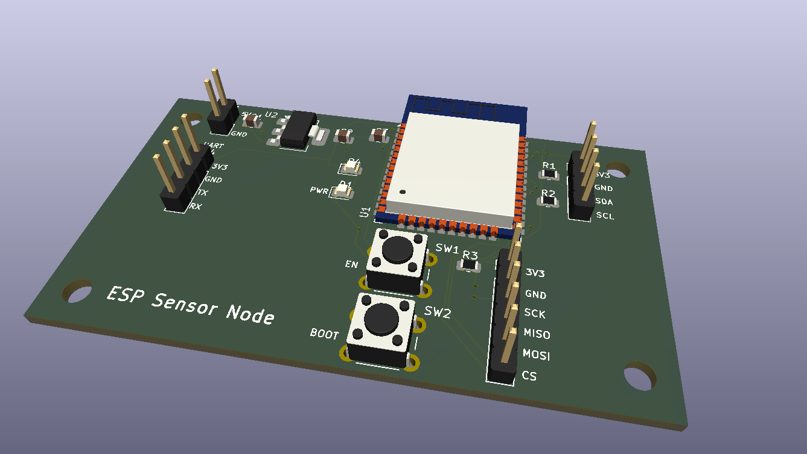

# ESP32 Sensor Node (2-Layer Custom PCB)

A compact, manufacturable 2-layer PCB built around the **ESP32-WROOM-32** module, designed in **KiCad**. The board provides regulated 3.3V power, dedicated I2C and SPI sensor interfaces, hardware reset/boot controls, and an external UART programming header.

## Key Features
* **Microcontroller:** ESP32-WROOM-32 with intentional board-edge antenna overhang and RF keep-out zone.
* **Power Supply:** 5V input (`J1`) regulated to 3.3V via an `AMS1117-3.3` LDO (`U2`) with local input/output decoupling (`C1`–`C3`) and a 3.3V power indicator LED (`D1`).
* **Interfaces:**
  * **UART (`J4`):** 4-pin header (`3V3`, `GND`, `TX`, `RX`) for external USB-to-UART flashing and serial debugging.
  * **I2C (`J2`):** 4-pin header (`3V3`, `GND`, `SDA`, `SCL`) with onboard 4.7kΩ pull-up resistors (`R1`, `R2`).
  * **SPI (`J3`):** 6-pin header (`3V3`, `GND`, `SCK`, `MISO`, `MOSI`, `CS`).
* **Controls:** Dedicated tactile `EN` (reset) and `BOOT` (IO0) buttons (`SW1`, `SW2`) for firmware flashing.
* **Mechanical:** 4× symmetrical M3 mounting holes for enclosure or standoff mounting.

## PCB Design Highlights
* **2-Layer Stackup:** Signal routing prioritized on the top layer (`F.Cu`) with a solid, uninterrupted ground pour on the bottom layer (`B.Cu`) to minimize return-path impedance.
* **RF Layout:** ESP32 PCB antenna extends past the `Edge.Cuts` outline with no copper or ground plane underneath.
* **Component Placement:** Decoupling capacitors placed adjacent to the `AMS1117-3.3` and `ESP32` power pins; 0805 SMD passives chosen for reliable hand-soldering and rework.
* **DFM & Verification:** Passed KiCad DRC with **0 errors** and **0 unconnected nets**; complete silkscreen pinout labeling for benchtop bring-up.

## Repository Structure
* `/hardware` — Native KiCad schematic, PCB layout, and project files.
* `/manufacturing` — Fab-ready Gerber & Excellon drill archive (`gerbers.zip`) and Bill of Materials (`BOM.csv`).
* `/docs` — Printable schematic PDF and 3D board renders.
